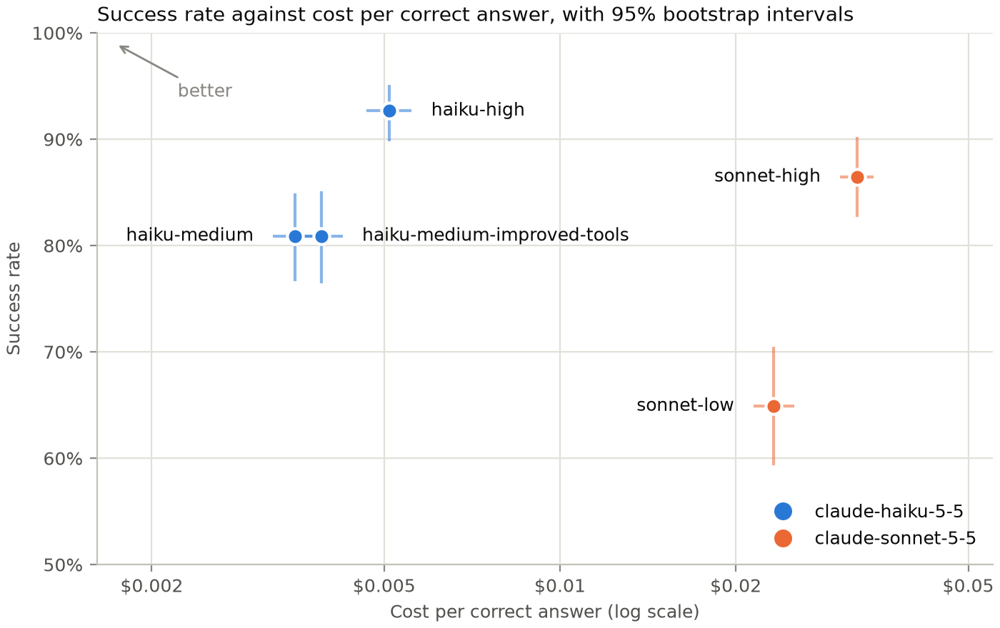
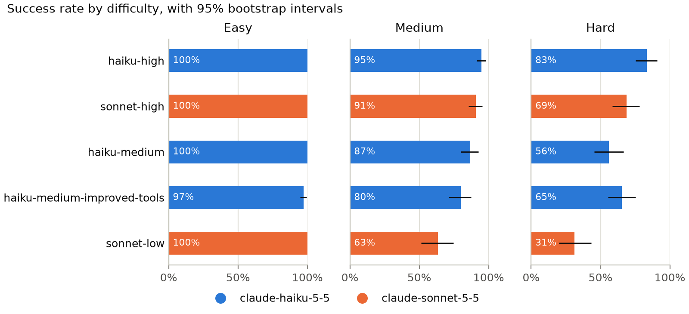

# agent-tool-eval


agent-tool-eval measures how often a tool-using LLM agent solves delivery-scheduling tasks that
each have an exact answer, and what each correct answer costs.

Is a strong model at low reasoning effort cheaper per correct answer than a cheap model at high
effort? On 150 generated tasks, no. Claude Haiku 5.5 at high effort was right on 92.7% of runs,
against 64.9% for Claude Sonnet 5.5 at low effort (a gap of 27.8 percentage points, 95% interval
21.6 to 33.8), and each of Sonnet's correct answers cost 4.5 times as much (4.1 to 5.1 times).



## Results

Five configurations of the agent each ran three times on the same 150 tasks: 2,250 runs, for
$24.15 in all. A run is correct when its answer is as good as the exact one: a delivery order that
makes every delivery on time and finishes at the same minute, or "no solution" when there is none.
The intervals are 95% bootstrap intervals that resample the tasks within each difficulty.

| Configuration                 | Model             | Effort | Tool descriptions | Success           | Cost per correct answer | Total cost |
| ----------------------------- | ----------------- | ------ | ----------------- | ----------------- | ----------------------- | ---------- |
| `haiku-high`                  | Claude Haiku 5.5  | high   | basic             | 92.7% (89.8–95.1) | $0.0051 (0.0047–0.0056) | $2.13      |
| `sonnet-high`                 | Claude Sonnet 5.5 | high   | basic             | 86.4% (82.7–90.2) | $0.0323 (0.0302–0.0344) | $12.55     |
| `haiku-medium`                | Claude Haiku 5.5  | medium | basic             | 80.9% (76.7–84.9) | $0.0035 (0.0032–0.0039) | $1.28      |
| `haiku-medium-improved-tools` | Claude Haiku 5.5  | medium | improved          | 80.9% (76.4–85.1) | $0.0039 (0.0036–0.0042) | $1.42      |
| `sonnet-low`                  | Claude Sonnet 5.5 | low    | basic             | 64.9% (59.3–70.4) | $0.0232 (0.0214–0.0252) | $6.77      |



### Paired comparisons

The first comparison is the research question. Each of the others changes one thing. Both
configurations of a comparison ran the same tasks, so the comparisons are paired.

| a vs b                                          | What changes                                             | Success, a minus b            | Holm p | Cost per correct, a over b |
| ----------------------------------------------- | -------------------------------------------------------- | ----------------------------- | ------ | -------------------------- |
| `sonnet-low` vs `haiku-high`                    | strong model at low effort vs cheap model at high effort | -27.8 points (-33.8 to -21.6) | 0.0005 | 4.54x (4.07–5.07)          |
| `haiku-high` vs `haiku-medium`                  | effort, on Haiku                                         | +11.8 points (+7.3 to +16.0)  | 0.0005 | 1.45x (1.35–1.56)          |
| `sonnet-high` vs `sonnet-low`                   | effort, on Sonnet                                        | +21.6 points (+16.7 to +26.4) | 0.0005 | 1.39x (1.29–1.50)          |
| `sonnet-high` vs `haiku-high`                   | the model, at high effort                                | -6.2 points (-10.2 to -2.2)   | 0.0074 | 6.32x (5.82–6.84)          |
| `haiku-medium-improved-tools` vs `haiku-medium` | the tool descriptions                                    | +0.0 points (-4.2 to +4.0)    | 1.0    | 1.11x (1.04–1.20)          |

The p-values come from a paired sign-flip permutation test on each task's share of correct runs,
with 10,000 flips, adjusted by Holm's method over the five comparisons. The smallest adjusted
p-value that 10,000 flips can give is 0.0005. With 150 tasks, these comparisons can detect
differences of about 6 to 10 points, at level 0.05 with power 0.8.

**A cheap model at high effort beat a strong model at low effort on both accuracy and cost.** This
answers the research question at the top. Haiku at high effort was right 27.8 points more often
than Sonnet at low effort (21.6 to 33.8, Holm-adjusted p = 0.0005), and Sonnet's correct answers
cost 4.54 times as much (4.07 to 5.07).

**Higher effort paid off on both models, for much less than a larger model costs.** On Haiku,
going from medium to high effort raised success by 11.8 points (+7.3 to +16.0, adjusted
p = 0.0005), and on Sonnet, going from low to high, by 21.6 points (+16.7 to +26.4, adjusted
p = 0.0005). It made each correct answer 1.4 to 1.5 times as expensive (1.45 on Haiku, 1.39 on
Sonnet), while at high effort Sonnet's correct answers cost 6.3 times Haiku's. All of the gains
came from medium and hard tasks: every configuration with the basic tool descriptions was right on
every easy task in every run.

**At high effort, the larger model was less accurate than the smaller one.** Sonnet at high effort
was right 6.2 points less often than Haiku at high effort (-10.2 to -2.2, adjusted p = 0.0074), at
6.32 times the cost per correct answer (5.82 to 6.84). The runs don't show why. The three repeats
per task mattered here: on the first repeat alone, an exact McNemar test gives p = 0.68.

**The improved tool descriptions didn't change the success rate, and cost more.** With either set
of descriptions, Haiku at medium effort was right on 80.9% of runs (a difference of +0.0 points,
-4.2 to +4.0, adjusted p = 1.0), so the data rule out a gain or a loss of more than about 4
points. Each correct answer cost 1.11 times as much (1.04 to 1.20): the runs wrote about 440 more
output tokens each, and every request carries the longer descriptions.

**Almost every wrong answer was an on-time schedule that finished too late.** Of the 424 wrong
answers across all five configurations, 415 delivered every order on time but finished later than
the exact answer. The agents rarely broke the rules; they stopped at a good delivery order instead
of finding the best one.

## What didn't work

**The first tasks were too easy.** In a pilot on 20 tasks with 1 to 5 orders, Haiku at medium
effort was right on 19. Simple rules were often enough: on random tasks with 2 to 5 orders, at
least one of three rules (by window opening, by window closing, nearest next) found the best
delivery order in 77% to 98% of them, depending on the number of orders. The generator moved to
2–3, 4–5 and 6–7 orders, and now keeps a task with a solution only if no simple rule finds its
best delivery order.

**The new tasks were still too easy, because the time windows were tight.** In the first
calibration, on 20 of the new tasks, 93 of 100 runs were right and the best configuration got
all 20. With windows 30 to 90 minutes wide, a task had few on-time orderings of its deliveries,
often just one, so any on-time answer was also the best. Widening the windows to 60–150 minutes
raised the median number of on-time orderings of a hard task from 6 to 36.

**Six runs hit the output limit.** All six were Haiku at high effort on hard tasks, and each ended
when a single response reached the 32,000-token limit, after 4 or 5 requests and 2.5 to 4 minutes.
Five were on task-146 and task-148, which have no solution, and which every other configuration
answered correctly in all three repeats; the sixth was on task-112, which has one. They count as
wrong answers. Counted as right, they would raise Haiku at high effort from 417 to 423 of 450
correct, and change no ranking. At high effort, the small model can apparently spiral when it
tries to prove that no delivery order works.

**The improved tool descriptions didn't help.** They say more about what each tool returns, ask
for several calls at once, and point out that a partial schedule can be checked before it's
extended. Success stayed at 80.9%, and each correct answer cost 11% more. By difficulty, they did
better on hard tasks (65% against 56%) and worse on easy and medium ones (97% against 100%, 80%
against 87%).

## Limitations

- All 150 tasks come from one synthetic generator: delivery scheduling in random cities of 8 to 12
  places, kept only when no simple rule solves them. The results are about tasks like these, not
  about agents in general.
- Two models from one provider, each at two effort levels, with one system prompt and one agent
  loop.
- With 150 tasks, differences smaller than about 6 to 10 points can't reliably be told apart from
  noise.
- The improved descriptions are one rewrite. A different one could do better or worse.
- Costs use the API prices of October 2026.

## How it works

- **The task.** A courier starts at minute 0 and must deliver every order to its place inside the
  order's time window, and may wait when early. Every road has a driving time in minutes; some are
  one-way, and some are closed for the day. The agent must find the delivery order that finishes
  the last delivery as early as possible, or answer that no delivery order makes every delivery on
  time. (`env/`)
- **The tools.** The agent sees a task only through six tools: `get_order`, `roads_from`,
  `route_minutes`, `shortest_route`, `check_schedule` and `submit_answer`. (`env/tools.py`,
  `agent/tool_specs.py`)
- **Exact answers.** A Held-Karp dynamic program over subsets of orders gives every task's exact
  answer. It agrees with a brute-force search over every delivery order on 2,000 random tasks.
  (`solver/`)
- **The tasks.** 150 seeded tasks, 50 at each difficulty: 2–3, 4–5 or 6–7 orders, each task in its
  own random city of 8–12 places. At each difficulty, 8 tasks have no solution, although each of
  their orders alone could be delivered on time. A task with a solution is kept only if no simple
  rule (by window opening, by window closing, nearest next) finds its best delivery order.
  (`env/generate.py`, `data/tasks.jsonl`)
- **The agent.** A tool-use loop over the Claude Messages API, with prompt caching, at most 30
  requests per run and at most 32,000 output tokens per response. (`agent/loop.py`)
- **The experiment.** One TOML file per configuration. Every run is graded against the exact
  answer, priced from its token usage and appended to a JSONL log. The log lets an interrupted
  experiment resume where it left off, and stop when it reaches its budget. (`configs/`,
  `experiment/`, `runs/`)
- **The analysis.** Stratified bootstrap intervals, paired sign-flip tests with Holm's adjustment,
  a power analysis, and the plots above. Simulations in the tests check that the intervals cover
  the true value about 95% of the time, and that when two configurations are equally good, the
  test finds a difference only about 5% of the time. (`analysis/`)

## Running it

With [uv](https://docs.astral.sh/uv/) installed:

```bash
uv sync
uv run pytest
```

The run logs are in the repository, so the analysis needs no API key:

```bash
uv run agent-eval report runs
uv run agent-eval plots runs --out figures
```

Running the agent calls the Claude API, so it needs `ANTHROPIC_API_KEY` in the environment and
costs money: each configuration here cost between $1.28 and $12.55 for its 450 runs.

```bash
uv run python -m agent_eval.agent.run --task task-100
uv run agent-eval run configs/haiku-high.toml --sample 20 --budget 1 --out my-runs/haiku-high.jsonl
```

The tasks come from a seed, and the same seed gives the same file, byte for byte:

```bash
uv run python -m agent_eval.env.generate --seed 0
```
